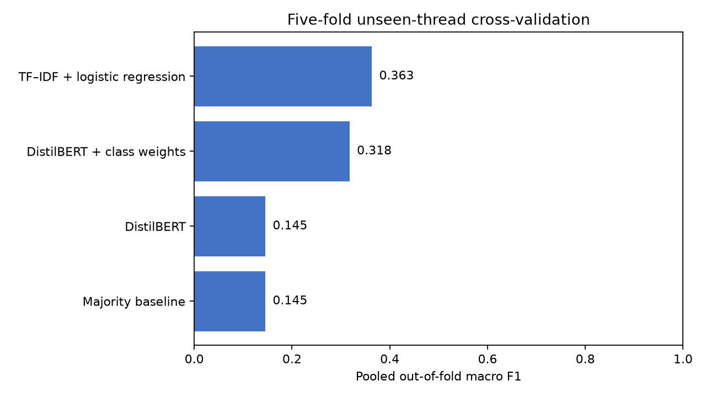

# Craft Forum Discourse Classification

Craft Forum NLP is a small benchmark for classifying how people participate in art and craft
forums. It distinguishes technical help, showcase reactions, critique, and broader opinion while
keeping every source thread intact during evaluation.

## Result

TF–IDF with class-balanced logistic regression achieved **0.363 pooled out-of-fold macro F1** in
five-fold thread-grouped cross-validation. Its fold scores ranged from 0.303 to 0.424, which is a
material amount of variation and a reason not to rely on one small held-out set.

| Model | Pooled accuracy | Pooled macro F1 | Fold macro F1 range |
|---|---:|---:|---:|
| Majority baseline | **0.410** | 0.145 | 0.132–0.164 |
| TF–IDF + logistic regression | 0.396 | **0.363** | 0.303–0.424 |
| DistilBERT | **0.410** | 0.145 | 0.132–0.164 |
| DistilBERT + class weights | 0.349 | 0.318 | 0.191–0.458 |

Macro F1 is the primary metric because the four labels are imbalanced. Accuracy makes the majority
baseline look competitive even though it never recognizes three of the four classes.

Compared with the earlier single-split report, TF–IDF macro F1 increased from 0.310 to 0.363 while
its accuracy decreased from 0.405 to 0.396. The majority and unweighted DistilBERT results also
decreased, from 0.432 accuracy and 0.151 macro F1 to 0.410 and 0.145. The weighted DistilBERT result
improved, but remains below TF–IDF. These are different evaluation designs, so the changes describe
the new benchmark rather than a like-for-like model improvement.

## Dataset

The dataset contains 212 manually labeled excerpts from 28 public WetCanvas and KnittingHelp
threads. Each row includes its source URL and one of four labels:

- technical_help: troubleshooting or instruction about a specific method or material
- showcase_reaction: a primarily emotional or aesthetic response
- critique_feedback: a concrete evaluation of what is or is not working
- meta_opinion: a broader view about the craft, community, or materials

The label distribution ranges from 41 examples for critique_feedback to 87 for technical_help. See
[DATA.md](DATA.md) for provenance and reuse notes.

## Evaluation design

The benchmark uses StratifiedGroupKFold with five outer folds, shuffling enabled, and seed 42.
Grouping by source_url keeps every excerpt from a thread on the same side of each train/test
boundary. Every excerpt receives one out-of-fold prediction, and the pooled metrics use all 212
predictions.

| Fold | Test threads | Test excerpts | Missing labels |
|---:|---:|---:|---|
| 1 | 7 | 45 | None |
| 2 | 5 | 43 | None |
| 3 | 4 | 38 | None |
| 4 | 5 | 44 | None |
| 5 | 7 | 42 | None |

TF–IDF regularization is selected separately inside each outer training fold using four-fold
thread-grouped cross-validation over C = {0.25, 1.0, 4.0}. The outer test threads do not participate
in that choice. The majority baseline and both DistilBERT variants use the same five outer folds.

An earlier version generated candidate test folds and chose the one whose label distribution was
closest to the full dataset. It then used the same label-distribution rule to choose a validation
fold. Because both choices used labels from would-be held-out data, this version replaces them with
complete grouped cross-validation and reports every fold.

## Models and DistilBERT history

The benchmark compares the training-fold majority label, TF–IDF with class-balanced logistic
regression, and two fixed DistilBERT variants. DistilBERT uses:

- distilbert-base-uncased revision 12040accade4e8a0f71eabdb258fecc2e7e948be
- 3 epochs, learning rate 2e-5, and weight decay 0.01
- training batch size 16, test batch size 32, and maximum length 256
- CPU execution, deterministic PyTorch operations, and seed 42
- either ordinary cross-entropy or inverse-frequency class-weighted cross-entropy

The Git history shows that the original results write-up already used three epochs and suggested
class-weighted loss before the class-weighted benchmark variant was added. It does not show the
epoch count being changed after results were seen. The weighted variant is therefore reported as a
post-result diagnostic, not a preregistered improvement.

Unweighted DistilBERT predicts technical_help for every out-of-fold example. Class weighting
produces all four labels and improves macro F1, but its 0.318 pooled score and wide 0.191–0.458 fold
range do not beat TF–IDF.

## Reproduce the results

Python 3.11 or newer is required. The exact local command sequence used for the full benchmark is:

~~~bash
python -m venv .venv
source .venv/bin/activate
python -m pip install -r requirements-lock.txt
python -m pip install --no-deps -e .
craft-forum-benchmark --models majority tfidf distilbert distilbert_weighted
~~~

The pinned DistilBERT runs use CPU and are intentionally not part of CI. On the machine used for
this report, one fold containing both transformer variants took 89.32 seconds; the complete
five-fold benchmark took 151.92 seconds after the checkpoint was cached.

For the lightweight benchmark and tests:

~~~bash
python -m pip install -r requirements-ci.txt
python -m pip install --no-deps -e .
craft-forum-benchmark --models majority tfidf --output-dir /tmp/craft-forum-results
pytest
~~~

The tracked [results directory](results/) contains the fold assignments, per-excerpt out-of-fold
predictions, pooled and per-fold metrics, parameters, package versions, and figures. Fast tests
verify thread isolation and recompute every published metric from the saved predictions without
running DistilBERT.

## Code path

1. [data.py](src/craft_forum_nlp/data.py) validates the CSV and label contract.
2. [splits.py](src/craft_forum_nlp/splits.py) creates the five outer folds and grouped inner folds.
3. [models.py](src/craft_forum_nlp/models.py) evaluates the majority and TF–IDF baselines.
4. [transformer.py](src/craft_forum_nlp/transformer.py) runs the fixed DistilBERT variants.
5. [reporting.py](src/craft_forum_nlp/reporting.py) saves out-of-fold evidence and figures.

[benchmark.py](src/craft_forum_nlp/benchmark.py) coordinates those steps. It contains no model
implementation.

## Repository layout

~~~text
.
├── src/craft_forum_nlp/    # validation, splits, models, and reporting
├── tests/                  # integrity and saved-result checks
├── results/                # fold assignments, predictions, metrics, and figures
├── craft_forum_dataset.csv # 212 labeled excerpts with source URLs
├── DATA.md                 # dataset provenance and reuse notes
├── pyproject.toml
└── requirements-lock.txt
~~~

This project began as a CodePath AI201 NLP exercise. The evaluation pipeline and published
benchmark were subsequently rebuilt to test generalization across unseen source threads.
